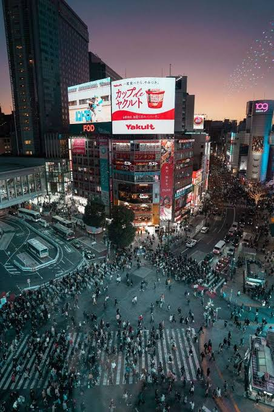

**netvlad-rs** - Pure rust implementation (using [candle](https://github.com/huggingface/candle) ML framework) of
[NetVLAD](https://aihub.qualcomm.com/compute/models/netvlad), a deep learning model for place recognition and image
retrieval.

Only about 200 loc of [lib.rs](src/lib.rs), which contain `load_model()` and `run()`.

| Query                                    | Sample_0 (67.58 %)                         | Sample_1 (68.71 %)                         | Sample_2 (73.07 %)                         |
|------------------------------------------|--------------------------------------------|--------------------------------------------|--------------------------------------------|
|  |  |  |  |
