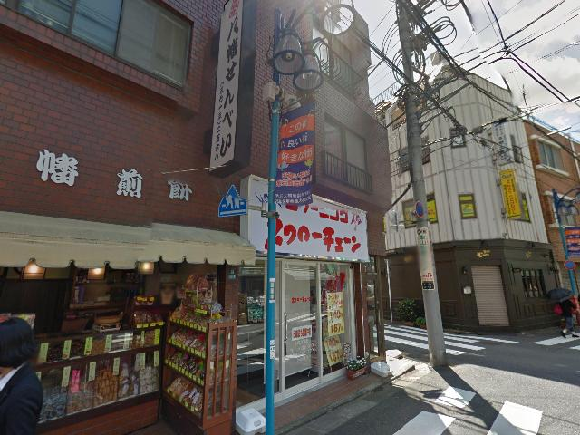
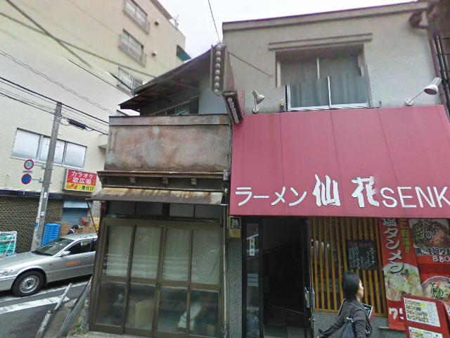
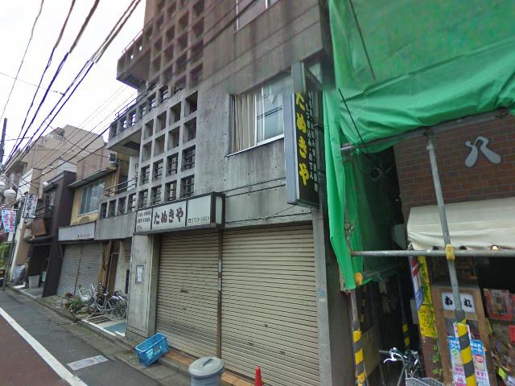
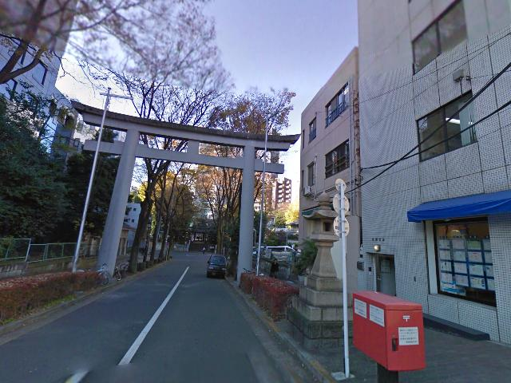
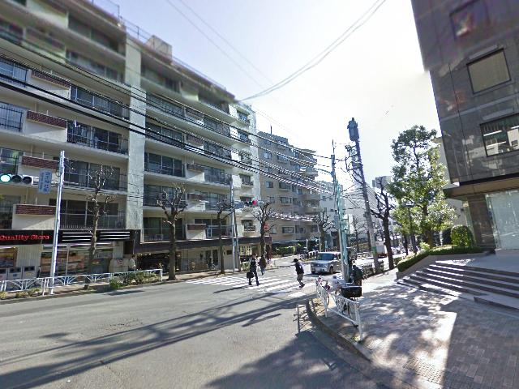
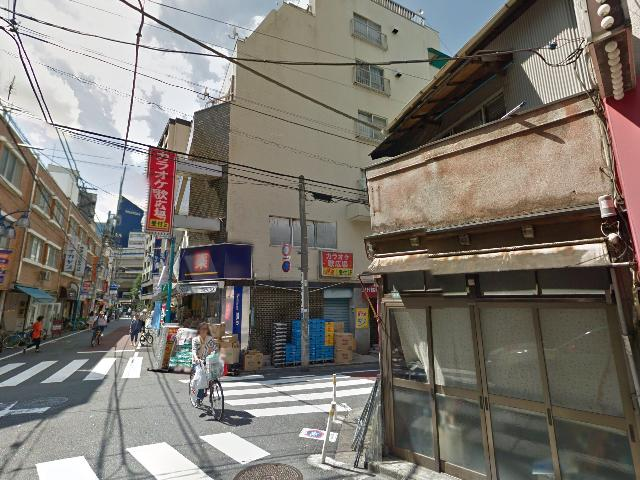

**netvlad-rs** - Pure rust implementation (using [candle](https://github.com/huggingface/candle) ML framework) of
[NetVLAD](https://aihub.qualcomm.com/compute/models/netvlad), a deep learning model for place recognition and image
retrieval.

Only about 200 loc of [lib.rs](src/lib.rs), which contain `load_model()` and `run()`.

```terminaloutput
inference for 'images/sample0.jpg' took 829.2211ms
inference for 'images/sample1.jpg' took 795.2083ms
inference for 'images/sample2.jpg' took 797.4071ms
inference for 'images/sample3.jpg' took 805.7585ms
inference for 'images/sample4.jpg' took 819.9945ms
sample 'images/sample0.jpg': matching = 79.87%
sample 'images/sample1.jpg': matching = 69.23%
sample 'images/sample2.jpg': matching = 76.43%
sample 'images/sample3.jpg': matching = 64.20%
sample 'images/sample4.jpg': matching = 79.28%
```

| Query                                    | Sample_0                                   | Sample_1                                   | Sample_2                                   | Sample_3                                   | Sample_4                                   |
|------------------------------------------|--------------------------------------------|--------------------------------------------|--------------------------------------------|--------------------------------------------|--------------------------------------------|
|  |  |  |  |  |  |
